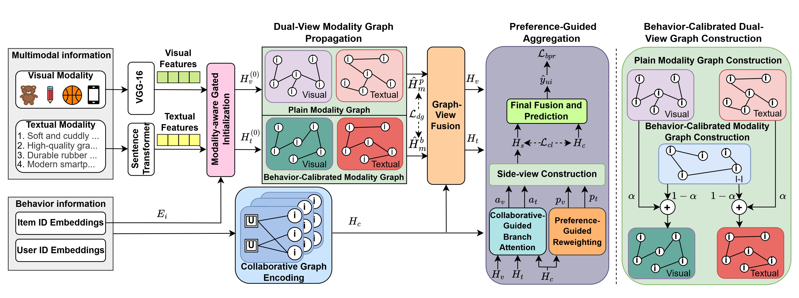
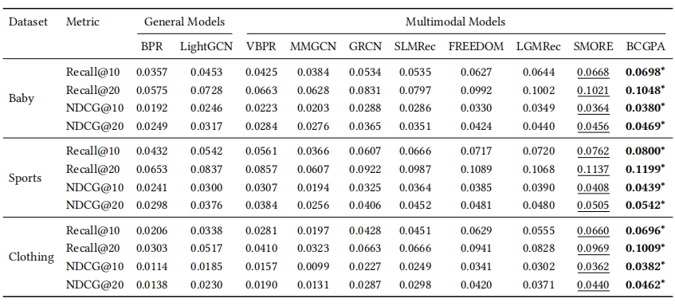

# BCGPA

This repository provides the PyTorch implementation of **BCGPA**:
**Behavior-Calibrated Dual-View Modality Graph Propagation with Preference Aggregation for Multimodal Recommendation**.

## Overview



## Environment Requirement

The code was tested with Python 3.10.5 and PyTorch 2.10.0+cu128. The minimum requirements are:

- Python >= 3.7
- PyTorch >= 1.13.0
- NumPy >= 1.21.0
- SciPy >= 1.7.0
- pandas >= 1.3.0
- PyYAML >= 6.0

Install dependencies:

```bash
pip install -r requirements.txt
```

## Dataset

Use the processed Baby, Sports, and Clothing benchmarks following the data format below. Dataset files are not included in this anonymous repository.

The data comprises text and image features extracted from Sentence-Transformers and CNN.

Expected data structure:

```text
data/
  baby/
    baby.inter
    image_feat.npy
    text_feat.npy
  sports/
    sports.inter
    image_feat.npy
    text_feat.npy
  clothing/
    clothing.inter
    image_feat.npy
    text_feat.npy
```

## How to run

Place the downloaded data, e.g., `baby`, into the `data` directory.

Enter the `src` folder and execute the following command:

```bash
python main.py -m BCGPA -d baby
```

Other parameters can be set either through the command line or by using the configuration files located in `configs/model/BCGPA.yaml` and `configs/dataset/*.yaml`.

## Performance Comparison



## Best hyperparameters for reproducibility

We present the optimal hyperparameters for BCGPA to replicate the results shown in Table 2 of our paper:

| Datasets | n_ui_layers | n_layers | image_knn_k | text_knn_k | behavior_graph_alpha | cl_loss | dual_graph_cl_weight | reg_weight | dropout_rate |
| --- | ---: | ---: | ---: | ---: | ---: | ---: | ---: | ---: | ---: |
| Baby | 4 | 1 | 40 | 10 | 0.6 | 0.01 | 0.002 | 1e-04 | 0.1 |
| Sports | 3 | 1 | 10 | 10 | 0.3 | 0.03 | 0.002 | 1e-04 | 0 |
| Clothing | 3 | 1 | 15 | 10 | 0.5 | 0.01 | 0.002 | 1e-05 | 0 |

## Citation

If you find BCGPA useful in your research, please consider citing our paper.

```bibtex
@inproceedings{bcgpa2027,
  title     = {Behavior-Calibrated Dual-View Modality Graph Propagation with Preference Aggregation for Multimodal Recommendation},
  author    = {Anonymous Author(s)},
  booktitle = {Proceedings of the ACM International Conference on Web Search and Data Mining},
  year      = {2027}
}
```

This code is made available solely for academic research purposes.

## Acknowledgement

The structure of this code is inspired by the MMRec framework. We acknowledge and appreciate their valuable contributions.
